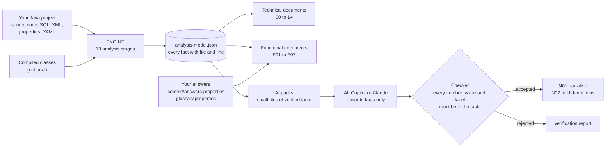
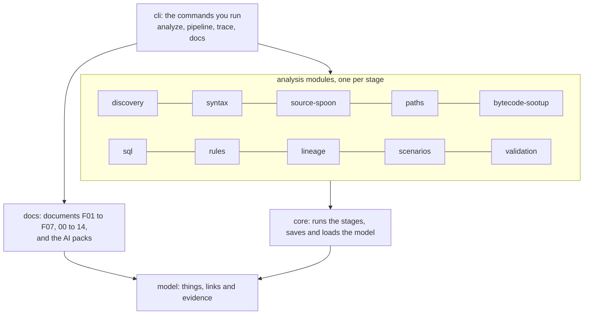
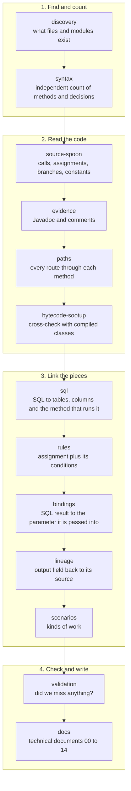
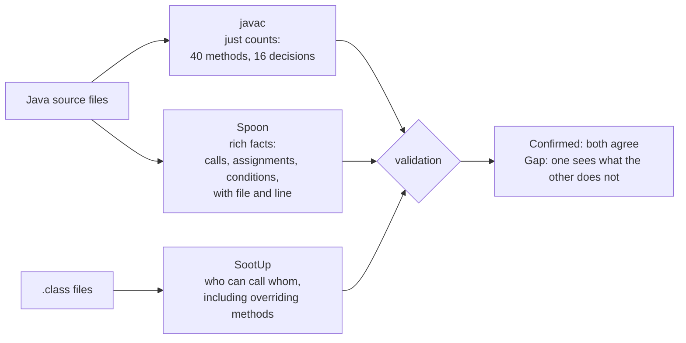
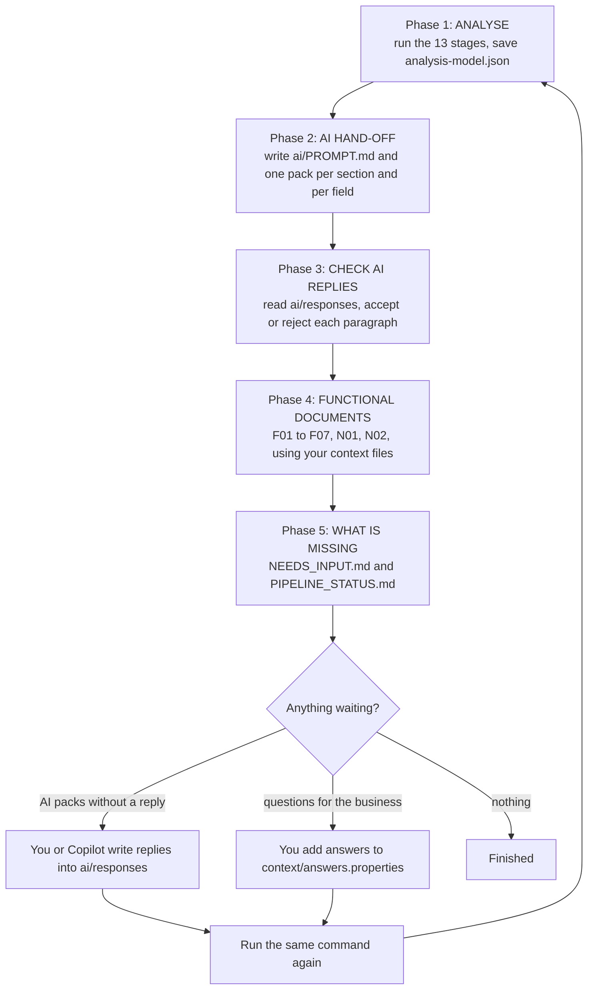
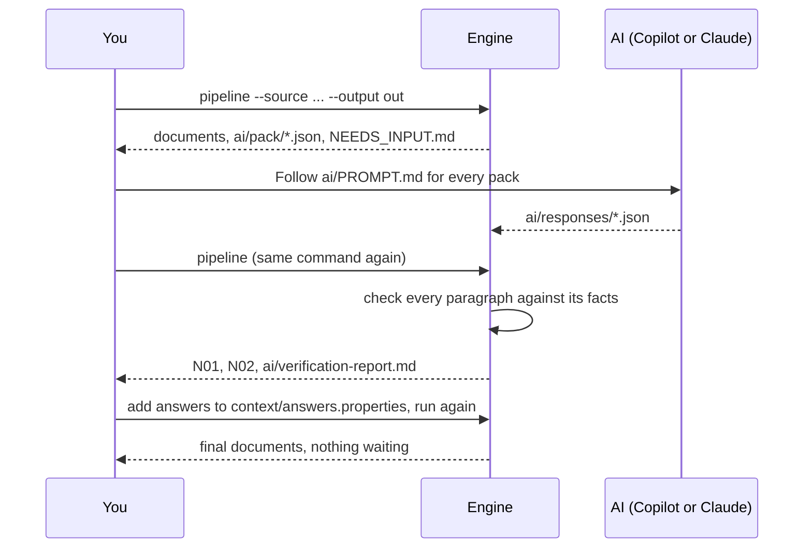

# Architecture: how the engine works

This page explains the engine with pictures. Read it top to bottom; each part adds one idea.

**What the engine does, in one sentence:** it reads a Java project (without running it), finds out where every value in an output file comes
from, and writes documents that a business analyst can read. An AI may reword the facts, but it can never add one.

---

## 1. The big picture



Three ideas to remember:

1. **Facts first.** Everything comes from the code, with a file and line behind it. Nothing is guessed.
2. **One saved model.** All stages read and write the same model (`analysis-model.json`). Documents are generated from it, so they can be rebuilt at any time.
3. **The AI is a writer, not a source.** It gets small packs of facts, and a checker throws away anything that is not in them.

---

## 2. The building blocks (modules) and what each is for




| Module | What it is for | Plain example |
|---|---|---|
| **model** | The shared vocabulary: things (class, method, SQL statement, column, output field), links between them (calls, reads column, derived from) and the evidence (file, line) | "method `findDue` EXECUTES statement SELECT_DUE" |
| **core** | Runs the stages in order, logs what each did, saves and loads the model | The conveyor belt |
| **discovery** | Finds Java, XML, SQL, properties and YAML files, and the modules in a Maven project | "12 Java files, 1 SQL file, 1 module" |
| **syntax** | Counts methods and decisions with the JDK's own parser; attaches Javadoc and comments | "40 methods, 16 decisions" (the yardstick) |
| **source-spoon** | Spoon reads the source as a tree: every call, assignment, branch and constant | `fee = BASE_FEE.add(...)` at `FeeCalculator.java:12` |
| **paths** | Turns decisions into routes: the conditions that select a route and what it does | "when shipped is positive, fee is charged" |
| **bytecode-sootup** | SootUp reads compiled classes and builds a call graph, to cross-check what Spoon saw | "97 calls confirmed by source and bytecode" |
| **sql** | Finds SQL anywhere (Java strings, XML, properties), parses it, links it to the method that runs it | "SELECT reads `shipment.quantity`" |
| **rules** | Joins each assignment with the conditions around it | "when quantity is zero, status is ARCHIVED" |
| **lineage** | Finds the output file and traces each field back to its source | "quantity <- new quantity <- fee <- shipped <- `shipment.quantity`" |
| **scenarios** | Finds the kinds of work (a handler chosen by a switch) | DISPATCH, STORAGE, ARCHIVE |
| **validation** | Compares the independent counts and reports every gap | "3 decisions not captured as rules" |
| **docs** | Writes documents F01 to F07, 00 to 14 and the AI packs | `F07_Field_Reference.md` |
| **cli** | The commands, and the `pipeline` workflow | `pipeline --source ... --output ...` |
| **sample-app / conformance** | A small demo project and golden files that the tests compare against | The shipping job |

---

## 3. How the pipeline works: 13 stages in order

Each stage reads what the earlier ones wrote and adds more to the model. The log shows, for every stage, **what** it does, what it **added**, what it **linked** and the **notes** it recorded.



| # | Stage | What it does | What it adds to the model |
|---|---|---|---|
| 1 | **discovery** | Walks every `--source` folder, lists files by kind, reads `pom.xml` for modules and their dependencies, skips tests | repository, modules, files |
| 2 | **syntax** | Parses every file with `javac` and counts methods and decision points, independent of Spoon | syntax units, decisions |
| 3 | **source-spoon** | Builds a syntax tree per file with no classpath needed. Records calls, `target = expression` assignments with line numbers, branches and constants | classes, methods, fields, call sites, expressions, `contains`, `invokes`, `derived from` links |
| 4 | **evidence** | Attaches comments and Javadoc to what they describe, word for word | a `doc` note on classes, methods and fields |
| 5 | **paths** | For each method builds the tree of decisions and flattens it into routes | paths and path decisions |
| 6 | **bytecode-sootup** | Loads `.class` files, builds a class-hierarchy call graph and compares it with the calls Spoon found (needs `--bytecode`, otherwise skipped) | extra call links; a note: how many calls are confirmed, only in source, only in bytecode |
| 7 | **sql** | Collects SQL from Java strings, `.sql`, MyBatis and iBatis XML, `.properties` and YAML; parses it; links statement to column, table and executing method | tables, columns, SQL statements, `reads column`, `executes` |
| 8 | **rules** | For every assignment, adds the conditions that guard it | business rules, `guarded by`, `applies rule` |
| 9 | **bindings** | A value read from the database and passed into another method links that method's parameter back to the column | `derived from` links across method boundaries |
| 10 | **lineage** | Finds the code that writes the output file (positions, widths) and follows every field backwards to a column, constant, runtime input or something outside the code | output file, output fields, transformations, traces marked VERIFIED, PARTIAL or UNRESOLVED |
| 11 | **scenarios** | Detects handler classes chosen by a switch or if-chain and attaches their methods, rules, SQL and fields | scenarios, `part of scenario` |
| 12 | **validation** | Cross-checks the independent counts; reports every gap | notes and warnings (nothing is silently dropped) |
| 13 | **docs** | Writes the technical documents from the model | files 00 to 14 |

### How Spoon, SootUp and javac work together

They look at the same code in three different ways, and the engine compares them. Agreement is evidence; a difference becomes a note.



- **javac** is the yardstick: it cannot explain, but it counts what exists.
- **Spoon** gives the detail that documents are built from. It works without a build, so unknown libraries are tolerated.
- **SootUp** proves the call graph from the compiled code and finds calls that source reading alone can miss.

### How the linking happens

The engine does not guess links; each one comes from a specific piece of evidence.

```mermaid
flowchart LR
    F["output field<br/>quantity<br/>characters 19 to 33"] -->|"written by"| W["writer expression<br/>amount(r.getQuantity(), 15)"]
    W -->|"getQuantity() returns"| R["record field<br/>quantity"]
    R -->|"assigned from"| C1["new quantity<br/>= quantity - shipped"]
    C1 -->|"derived from"| C2["shipped<br/>= min(quantity, ship cap)"]
    C2 -->|"derived from"| COL[("column<br/>shipment.quantity<br/>DECIMAL 15,2")]
    COL -->|"read by"| Q["SELECT ... FROM shipment<br/>WHERE status IN (...) AND due_date <= ?"]
    Q -->|"executed by"| M["ShipmentRepository.findDue"]
```



Where each link comes from:

| Link | Found by |
|---|---|
| field to writer expression | `lineage` (position from the `pad…` call, width from its arguments) |
| expression to assignment to assignment | `source-spoon` (`derived from`) |
| value passed through a constructor or method parameter | `source-spoon` argument links and `bindings` |
| assignment to its condition | `paths` and `rules` (`guarded by`) |
| value to table column | `sql` (the SELECT list, matched to the `rs.getBigDecimal("quantity")` call) |
| statement to executing method | `sql` (the method that passes the statement to `prepareStatement`, or looks up its key in XML or properties) |

If a link cannot be found, the trace is marked **PARTIAL** or **UNRESOLVED** and the document says why (for example "comes from a system property: ask the business").

---

## 4. From stages to documents: the `pipeline` command

The `pipeline` command wraps the 13 stages in five phases:



**When does the AI run?** After the first run, and only when you start it. The engine itself never calls an AI. The sequence:



**What the checker accepts:** a paragraph must cite fact ids, and each number, quoted value and ALL-CAPS label in it must appear in the facts it cites. It must not guess ("probably") and must contain no code. Anything else is dropped and listed in the verification report, and the original facts stay in the document unchanged.

---

## 5. A simple example, start to finish

The sample project is a small shipping job. Its output file has one fixed-width line per shipment.

**The code (simplified)**

```java
// ShipmentRepository: reads from the database
"SELECT id, status, quantity, rate_pct, due_date FROM shipment WHERE ..."

// DispatchService: one kind of work
BigDecimal shipped     = shipment.getQuantity().min(SHIP_CAP);   // SHIP_CAP = 500.00
BigDecimal newQuantity = shipment.getQuantity().subtract(shipped);
if (shipped.signum() > 0) {
    fee = feeCalculator.feeFor(shipped, shipment.getRatePct());
    newQuantity = newQuantity.add(fee);
}

// ManifestWriter: writes characters 19 to 33
amount(r.getQuantity(), 15)   // move decimal 2 right, drop decimals, pad with '0' to 15
```

**What each stage contributes to the answer for the field `quantity`**

| Stage | Contribution |
|---|---|
| discovery | finds `ShipmentRepository`, `DispatchService`, `ManifestWriter`, `schema.sql` |
| source-spoon | records the three assignments with file and line, and the call `amount(r.getQuantity(), 15)` |
| paths | notes that `fee` and the last assignment happen only when `shipped` is positive |
| sql | reads `quantity` from table `shipment` (type DECIMAL 15,2) and links the SELECT to `findDue` |
| rules | "when shipped is positive, new quantity is set to new quantity plus fee" |
| lineage | finds the field at characters 19 to 33 and traces it: quantity <- new quantity <- fee <- shipped <- `shipment.quantity` |
| scenarios | sees that the router picks DISPATCH, STORAGE or ARCHIVE by status, so the trace is listed per kind of work |
| validation | confirms every decision was captured; flags `adjustment` as PARTIAL (it comes from a system property) |
| docs | writes the field into F04 and F07 |

**What a reader gets (F07, simplified)**

```
Field: quantity     characters 19 to 33 (15 wide)
Changes with:       shipped (shipped is positive)
Path back (DISPATCH): quantity <- new quantity <- fee <- shipped <- shipment.quantity, shipment.rate_pct
How it is written:  1 take the value   2 move the decimal point 2 places right
                    3 drop the decimals   4 convert to text   5 pad with '0' to 15
Example (illustrative): 1234.56  ->  123456  ->  "000000000123456"   (15 characters, fits)
Width check:        fits
```

The same field with the AI step added: the AI receives the facts for `quantity` (`ai/pack/field-quantity.json`) and writes a short plain-English explanation. The checker accepts only the sentences whose numbers and labels appear in those facts, and the result goes to `N02_Field_Derivations.md`.

---

## 6. The files you will see

| Where | File | Use |
|---|---|---|
| output folder | `PIPELINE_STATUS.md` | What ran, what is waiting |
| | `F01` to `F07` | The functional documents for analysts. Start with F01; F07 has one section per field |
| | `00` to `14` | Technical documents: inventory, SQL, rules, paths, coverage, gaps |
| | `analysis-model.json` | The full saved model; the documents can be rebuilt from it |
| | `NEEDS_INPUT.md` | Questions the code cannot answer |
| | `N01_AI_Narrative.md`, `N02_Field_Derivations.md` | AI-worded text that passed the checker |
| `ai/` | `PROMPT.md`, `pack/`, `responses/`, `verification-report.md` | The AI hand-off |
| `context/` | `answers.properties`, `glossary.properties` | Your answers and business names. Never overwritten |

---

## 7. Limits to keep in mind

- The engine reads code; it never runs it. A value that exists only at run time (a system property, a database value) is reported as such.
- Reflection and dependency injection are not followed, so a handler chosen that way will not be recognised as a scenario.
- Formatting steps are expanded only for known idioms (`padLeft`, `padRight`, `String.format`, `movePointRight`, `setScale`, `longValue`, `trim`, case changes). Anything else shows no steps rather than a guess.
- Worked examples are computed from the formatting steps and are illustrations, not data.
