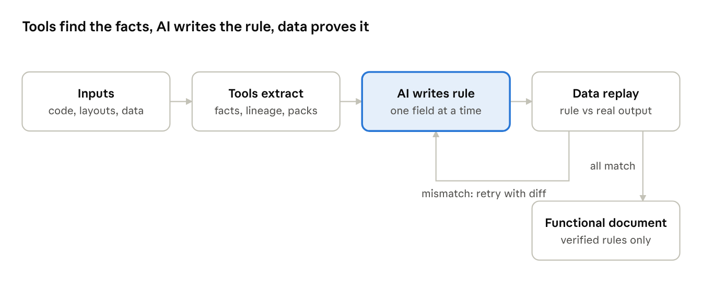
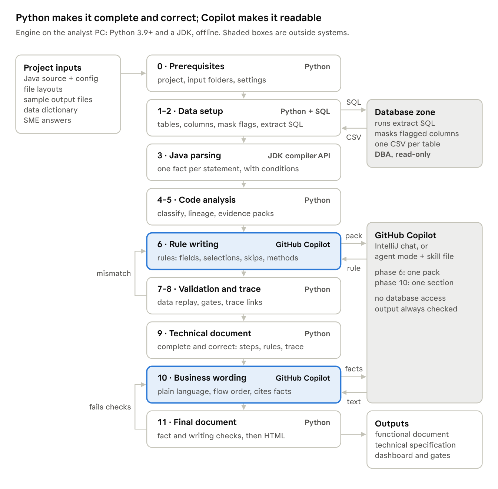

# From Source Code to Functional Documentation

White paper · 19 November 2026 · kampillichiru

## Summary

We turn a legacy Java batch into a functional document that a person with no knowledge of the code or the business can read, follow and rebuild from. The document is generated from the source code and the project inputs, and every rule in it is proven on real data.

The approach rests on three roles, each done by what does it best:

| Job | Done by | Why |
| --- | --- | --- |
| Find everything: every line, branch, query and write | Tools (a code parser) | A tool cannot skip a line |
| Explain it in plain business language | AI, one small piece at a time | AI is good at wording and meaning |
| Prove it is correct | Data replay | Input data + documented rules must give the exact output value |

The result: one document per module, organised by business flow and by output field, where each statement shows its source (a code line) and its proof (how many real records it reproduced). Once signed off, this document replaces the source code as the reference for the functionality.

## The problem

Legacy batch code holds years of business rules that nobody has written down. Classes run past 2,000 lines, conditions nest many levels deep, and the people who wrote them have moved on. The team that must rebuild the system needs every rule, for every case, in words they understand.

The two usual approaches both fall short:

| Approach | What goes wrong |
| --- | --- |
| A person reads the code | Slow across dozens of modules and hundreds of fields. The result depends on the reader, and nobody can check what was missed. |
| AI reads whole classes and writes the document | Long, nested code makes the AI drop conditions. The text always looks complete, so missing cases stay hidden. Repeating the prompt gives a new version, not a better one. |

What both lack is a way to **prove** the document is complete and correct. That proof is the centre of this approach.

## How the automation works

A set of tools (the engine) reads the inputs, extracts every fact from the code, and asks AI only for the wording of one small piece at a time. The analyst runs two commands; everything else is automatic.



Only the AI step needs language skills. A rule that fails the replay goes back to the AI with the failing records until every record matches.

| # | Stage | What happens | Done by |
| --- | --- | --- | --- |
| 1 | Import | Read the inputs: source code, file layouts, data dictionary, masked sample data | Tool |
| 2 | Parse | Turn every Java statement into a fact: file, line, condition chain, value assigned | Tool |
| 3 | Classify | Label every line as business, technical or logging, so nothing is skipped silently | Tool |
| 4 | Flow and queries | Build the call order from the entry point; resolve every SQL to table.column | Tool |
| 5 | Lineage | Trace each output position back to its source: a table column, a constant or a calculation | Tool |
| 6 | Conditions | Collect every branch on that path, the default Java behaviour, and where each error is caught | Tool |
| 7 | Evidence pack | Write one short file per rule: only the code lines, queries and sample values that matter | Tool |
| 8 | Rule | Turn the pack into a decision table plus plain-language steps | **AI** |
| 9 | Rule check | Check the format, and that every condition in the pack is used | Tool |
| 10 | Replay | Run the rule on the sample input data and compare with the real output, record by record | Tool |
| 11 | Flows | Group all paths into business flows; list the variants and which ones the data covered | Tool |
| 12 | Technical document | Assemble the complete and correct specification from the verified rules | Tool |
| 13 | Business wording | Word each section in plain language, citing the facts it uses | **AI** |
| 14 | Final document | Check the wording against the facts; publish | Tool |

A mismatch at stage 10 sends the failing records back to stage 8 as the next AI task. The loop repeats until every sample record matches.

The engine stops with an open **gate** until each of these holds: every line classified, every query resolved, every output position traced, every condition linked to a rule, every rule replayed.

## Technical architecture and pipeline

The engine is a set of Python scripts with one Java parser, run on the analyst's PC. GitHub Copilot in IntelliJ is the only AI component. One command runs every tool phase in order.



The pipeline works in two layers. Phases 0 to 9 make the documentation complete and correct in technical terms, with no AI writing beyond the individual rules. Only then does phase 10 give each section to Copilot to word in plain language, in flow order, as the existing system works today. Phase 11 checks that wording against the technical document before anything is published.

### Pipeline, phase by phase

| Phase | What it does | Technology | Output | Status |
| --- | --- | --- | --- | --- |
| 0. Prerequisites | Create the module project and its input folders; check that Python and a JDK are installed; set the module settings (entry point, output writer, file layouts) | Python | `project.json`, input folders | Built |
| 1. Data setup | List every table and column the code uses (from the parsed SQL and the column reads); add each column's description from the data dictionary; tag each column with a mask flag (personal data yes or no) for the analyst to confirm | Python | `data_fields.json`: table, column, type, description, mask flag | Partly built: columns found by lineage; mask tagging to build |
| 2. Data extraction | Generate one read-only extract query per table for the sample dates, with masking applied to flagged columns. The DBA runs them and saves one CSV per table | Python generates SQL; DBA runs it | `input/db_extract/*.csv` | To build (the engine already reads the CSVs) |
| 3. Java parsing | Read every Java file with the JDK's own compiler and write one fact per statement: file, line, condition chain, value assigned | Java (JDK compiler API) | `facts.jsonl` | Built |
| 4. Code analysis | Classify every line; build the call order and resolve the SQL; trace each output position to its source; collect conditions, default Java behaviour and error handling | Python | Line ledger, lineage, merger map | Built |
| 5. Evidence packs | Write one short pack per rule: code lines, queries, constants, sample values, decisions to cover | Python | `output/07_evidence/*.md` | Built |
| 6. Rule writing | Turn each pack into a rule: for each output field, record selection, skip condition and method | **GitHub Copilot** (chat, or agent mode with a skill file) | `rules/*.json` | Built (chat loop); agent mode to configure |
| 7. Validation | Check each rule's format and coverage; replay it on the extract; compare with the real output; check the database links; run the gates | Python | Verification reports, dashboard | Built |
| 8. Traceability | Link every statement to its code line, rule row and records; keep every AI attempt; list open questions | Python | Trace links, attempt log, question list | Built |
| 9. Technical document | Assemble the **complete and correct** technical specification: flow count and flow map from the end points, steps in code order, every verified rule as a table, examples, trace links. No AI | Python | Technical specification (per module, per flow, per field) | Field pages and scenarios built; flow catalogue to build |
| 10. Business wording | Rewrite each section of the technical document in plain language, in flow order, as the existing system works today. One section per prompt; every sentence cites the facts it uses | **GitHub Copilot** | Plain-language text per section | To build |
| 11. Final document | Check the wording against the technical document: every fact cited, no new codes, numbers or conditions, writing standard met. Merge the wording above the exact tables; publish | Python | Functional document (HTML), dashboard | To build |

### Running it with one launch

Yes, with one condition. One command runs every tool phase:

```
python engine/run_engine.py --project projects/<module>
```

The command runs the tool phases in order, skips nothing, and can be re-run at any time; every output is rebuilt from the inputs and the stored rules. Two steps are not scripts: the DBA runs the phase 2 queries once per sample date, and phase 6 is the AI. How it runs depends on the Copilot features enabled:

| Mode | How phase 6 runs | Launches needed |
| --- | --- | --- |
| Copilot Chat (available today) | The run stops and lists the waiting AI tasks. The analyst pastes each task into the chat and the answer back; the next command checks it at once | One launch, the AI loop, one more launch |
| Copilot agent mode with a skill file | One prompt such as "Document module X". The agent runs the command, reads the task, writes the rule, re-runs, and repeats until no task is left. The analyst approves each command | One prompt |
| AI through an API (not available at the office) | The engine calls the AI itself | One launch, unattended |

The skill file holds the fixed instructions: which command to run, which file to read, the answer format, and the rule never to edit inputs or outputs to make a rule pass. Copilot skills are already used at the office for SQL generation, so the same mechanism can host this one. Whether agent mode is enabled is to be confirmed.

## Worked example: one field through the whole pipeline

This example follows one output field through phases 0 to 11 in order: an employee code at positions 20 to 29 of an employee file. Names, data and counts are illustrative.

| Phase | What happens to the employee code | Done by |
| --- | --- | --- |
| 0. Prerequisites | The module project is set up | Python |
| 1. Data setup | The three columns it uses are found and flagged as personal | Python |
| 2. Data extraction | Their rows for the sample employees are extracted | Python + DBA |
| 3. Java parsing | Its code lines become facts | JDK |
| 4. Code analysis | Lines are classified; position 20 to 29 is traced to its columns | Python |
| 5. Evidence pack | The 20 relevant lines are put in one pack | Python |
| 6. Rule writing | The rule is written as a decision table | Copilot |
| 7. Validation | The rule reproduces all 248 sample records | Python |
| 8. Traceability | Every rule row is linked to code lines and records | Python |
| 9. Technical document | The complete technical section is generated | Python |
| 10. Business wording | The section is worded in plain language | Copilot |
| 11. Final document | The wording is checked and published with the tables | Python |

### Phase 0. Prerequisites (Python)

The analyst creates the project and fills in a few settings. Shortened:

```json
{"name": "employee_file",
 "modules": ["emp"],
 "entry_point": "EmpFileWriter.run",
 "records": {"position_writers": ["FixedWidth.put"]},
 "layout": "input/spec/emp_layout.csv"}
```

The Java source goes in `input/source/`, the file layout in `input/spec/`, two days of sample output files in `input/samples/`.

### Phase 1. Data setup (Python)

From the parsed SQL and the column reads, the tool lists every table and column the module uses, adds the data dictionary description, and proposes a mask flag. The analyst confirms the flags.

```json
[{"table": "EMP_DETAIL1", "column": "EMP_ID",        "type": "VARCHAR2(10)", "description": "Employee id",   "mask": false},
 {"table": "EMP_DETAIL1", "column": "FIRST_NAME",    "type": "VARCHAR2(40)", "description": "First name",    "mask": true},
 {"table": "EMP_DETAIL2", "column": "LAST_NAME",     "type": "VARCHAR2(40)", "description": "Last name",     "mask": true},
 {"table": "EMP_DETAIL3", "column": "DATE_OF_BIRTH", "type": "DATE",         "description": "Date of birth", "mask": true}]
```

### Phase 2. Data extraction (Python generates, DBA runs)

The tool writes one read-only query per table, limited to the employees in the sample files. The DBA runs them and saves one CSV per table.

```sql
-- generated for EMP_DETAIL1: rows behind the 248 sample records
SELECT EMP_ID, FIRST_NAME
FROM   EMP_DETAIL1
WHERE  EMP_ID IN (:sample_emp_ids);
```

```csv
EMP_ID,FIRST_NAME
E1001,Maria
E1002,Al
E1003,
```

The employee code is built from personal columns, so it changes if those columns are masked. Such fields are replayed where unmasked data is allowed; Copilot only ever sees masked values.

### Phase 3. Java parsing (JDK compiler)

The source code as it stands:

```java
private static final int P_EMPCODE = 19;   // 0-based, so position 20
private static final int L_EMPCODE = 10;

String buildEmpCode(Connection con, String empId) throws SQLException {
    String first = "";
    ResultSet r1 = query(con, "SELECT FIRST_NAME FROM EMP_DETAIL1 WHERE EMP_ID = ?", empId);
    if (r1.next()) first = r1.getString(1);

    String last = "";
    ResultSet r2 = query(con, "SELECT LAST_NAME FROM EMP_DETAIL2 WHERE EMP_ID = ?", empId);
    while (r2.next()) last = r2.getString(1);

    Date dob = null;
    ResultSet r3 = query(con, "SELECT DATE_OF_BIRTH FROM EMP_DETAIL3 WHERE EMP_ID = ?", empId);
    if (r3.next()) dob = r3.getDate(1);

    String a = fit3(first);
    String b = fit3(last);
    String c = (dob == null) ? "0000" : new SimpleDateFormat("ddMM").format(dob);
    log.debug("empcode parts " + a + b + c);
    return a + b + c;
}

private String fit3(String s) {
    if (s == null) return "   ";
    s = s.trim().toUpperCase();
    if (s.length() > 3) s = s.substring(0, 3);
    return String.format("%-3s", s);
}

// in writeRecord():
FixedWidth.put(rec, P_EMPCODE, L_EMPCODE, buildEmpCode(con, empId));
```

The parser turns every statement into a fact with its file, line and the conditions needed to reach it. One fact, shortened:

```json
{"line": 7, "kind": "ASSIGN", "text": "first = r1.getString(1);",
 "chain": [{"kind": "IF", "cond": "r1.next()", "branch": "THEN"}],
 "target": "first", "value": "r1.getString(1)"}
```

### Phase 4. Code analysis (Python)

| Finding | Result |
| --- | --- |
| Line classification | Line 20 (`log.debug`) is logging and is left out of the rule. Lines 6, 10 and 14 read data. All other lines are business logic. |
| Lineage | Positions 20 to 29 (constants 19 + 1 and 10) come from `buildEmpCode`, which uses EMP_DETAIL1.FIRST_NAME, EMP_DETAIL2.LAST_NAME and EMP_DETAIL3.DATE_OF_BIRTH, each found by EMP_ID |
| Conditions | Lines 7, 11, 15, 19, 25 and 27 decide the value |
| Default Java behaviour | `if (r1.next())` uses the first row only; `while (r2.next())` keeps the last row read; `String.format("%-3s")` pads on the right |
| Open point | The last-name query has no sort order, so which row is last depends on the database |

### Phase 5. Evidence pack (Python)

One short file with only what this field needs: the target and its positions, the three columns, the 20 business lines with logging removed and constants resolved, the sample values seen, and the six decisions the rule must cover (lines 7, 11, 15, 19, 25 and 27).

### Phase 6. Rule writing (Copilot)

Copilot reads the pack and returns a decision table in a fixed format. Each row cites its code lines. Shortened:

```json
{"title": "Employee code",
 "steps": [
  {"name": "A", "from": "EMP_DETAIL1.FIRST_NAME", "rows": [
     {"when": "no row found or name empty", "then": "3 spaces", "code": [7, 25]},
     {"when": "otherwise", "then": "trim, upper case, first 3 letters, pad right to 3", "code": [26, 27, 28]}]},
  {"name": "B", "from": "EMP_DETAIL2.LAST_NAME", "same_as": "A", "note": "several rows: the last row read is used", "code": [11]},
  {"name": "C", "from": "EMP_DETAIL3.DATE_OF_BIRTH", "rows": [
     {"when": "no row or empty", "then": "0000", "code": [15, 19]},
     {"when": "otherwise", "then": "day and month as ddMM", "code": [19]}]}],
 "result": "A + B + C",
 "open_questions": ["The last-name query has no sort order. Which row is last depends on the database."]}
```

### Phase 7. Validation (Python)

The engine checks the rule's format and that all six decisions are used. It then replays the rule on every sample record: it finds the rows in the three CSVs, applies the rule, and compares the result with positions 20 to 29 of the real file.

```text
TXT EMPCODE   positions 20-29   VERIFIED   248 of 248 records match
  A empty name    12 records    A from name   236 records
  C no birthdate   3 records    C from date   245 records
  links: EMP_DETAIL1 248 one row | EMP_DETAIL2 245 one row, 3 two rows | EMP_DETAIL3 245 one row, 3 none
```

Had the AI missed the padding of short names, the two-letter names would fail here and go back to phase 6 with the difference shown.

### Phase 8. Traceability (Python)

| Statement | Code lines | Proven on |
| --- | --- | --- |
| Empty first name gives 3 spaces | 7, 25 | 12 records |
| Name is trimmed, in capitals, cut and padded to 3 | 26, 27, 28 | 236 records |
| Several last names: the last read is used | 11 | 3 records |
| No birth date gives 0000 | 15, 19 | 3 records |

### Phase 9. Technical document (Python, no AI)

The generator assembles the complete and correct section from the verified rule. Each fact gets an ID for the next phase.

```text
EMPCODE  TXT 20-29  length 10  VERIFIED 248/248
Inputs  A = EMP_DETAIL1.FIRST_NAME by EMP_ID (first row)
        B = EMP_DETAIL2.LAST_NAME by EMP_ID (last row read)
        C = EMP_DETAIL3.DATE_OF_BIRTH by EMP_ID (first row)
F1  A: no row, or FIRST_NAME null or empty  -> 3 spaces              [7, 25]
F2  A: otherwise -> trim, upper case, first 3 characters, pad right   [26-28]
F3  B: as F1 and F2 on LAST_NAME; several rows -> last row read       [11]
F4  C: no row, or DATE_OF_BIRTH null        -> 0000                   [15, 19]
F5  C: otherwise -> day and month as ddMM                             [19]
F6  Result = A + B + C, always 10 characters                          [21, 32]
Q1  Open: the EMP_DETAIL2 query has no sort order
```

### Phase 10. Business wording (Copilot)

Copilot receives only that section and returns plain language, citing the facts each sentence uses:

> The employee code has 10 characters [F6]. It joins the first three letters of each name with the day and month of birth [F2, F3, F5]. Names are used in capitals, without spaces at either end [F2]. A missing part never shortens the code [F6]. Missing names become spaces, and a missing birth date becomes 0000 [F1, F4].

### Phase 11. Final document (Python)

The tool checks the wording before it is published:

| Check | Result |
| --- | --- |
| Every fact F1 to F6 cited at least once | Passed |
| No code, number or condition that is not in the facts (10, three, 0000 all appear in F1 to F6) | Passed |
| No reason given that is not backed by an SME answer | Passed |
| Sentences under 20 words, glossary terms only | Passed |

The published field card puts the wording on top of the exact tables:

**EMPCODE: Employee code** · Positions 20 to 29 · 10 characters · Verified on 248 records

The employee code has 10 characters. It joins the first three letters of each name with the day and month of birth. Names are used in capitals, without spaces at either end. A missing part never shortens the code. Missing names become spaces, and a missing birth date becomes 0000.

**How it is built**

1. Take the first name of the employee. Then:

   | When | Then part A is |
   | --- | --- |
   | No first name is found, or it is empty | 3 spaces |
   | In all other cases | the name without leading or trailing spaces, in capitals, cut to 3 letters, filled with spaces to 3 |

2. Take the last name the same way to get part B. If more than one last name is found, the last one read is used.
3. Take the date of birth. Then:

   | When | Then part C is |
   | --- | --- |
   | No date of birth is found, or it is empty | 0000 |
   | In all other cases | day and month as 4 digits, day first (6 June becomes 0606) |

4. Join A, B and C. The result is always 10 characters.

**Examples**

| First name | Last name | Date of birth | Employee code |
| --- | --- | --- | --- |
| Maria | Garcia | 6 June 1985 | `MARGAR0606` |
| Al | Li | 1 January 1990 | `AL LI 0101` |
| (none) | Garcia | 6 June 1985 | `   GAR0606` |
| Maria | Garcia | (none) | `MARGAR0000` |

**Open point:** when an employee has several last names, which one is used depends on the database order.

**Trace:** EmpFileWriter.java lines 4 to 32 · tables EMP_DETAIL1, EMP_DETAIL2, EMP_DETAIL3

## Where AI is used

AI does the work that needs language and judgement; tools do the work that needs completeness and exactness. Every AI output is checked before it is used.

| AI task | Input to AI | Output from AI | How it is checked |
| --- | --- | --- | --- |
| Write a rule (field, record selection, skip, method) | One evidence pack | Decision table (JSON) + plain-language steps | Format check; every condition used; replay on real data |
| Fix a failing rule | The pack + the records that do not match | Corrected rule | Replay again |
| Review a rule (second opinion) | The pack + the rule, in a separate prompt | List of missed or wrong conditions | The analyst accepts or rejects; replay |
| Word one section of the document | One section of the technical document, each fact with an ID | Plain-language text, in flow order, citing the fact IDs | Every fact cited; no new codes, numbers or conditions; writing standard met |
| Name things in business terms | Column descriptions, code lists, SME answers | Plain names for fields, codes and steps | Marked "meaning not confirmed" until an SME confirms |
| Propose test cases | Rule lines the data never reached | Test inputs and expected results | Reviewed by the analyst; run later |
| Draft questions for SMEs | Open points found by the tools | Short, precise questions | Sent by the analyst |

What AI does **not** do:

- Read whole classes or the whole code base at once.
- Decide whether the documentation is complete. The gates do that.
- Decide whether a rule is correct. The replay does that.
- Run anything, or reach the database.

With only an AI chat in the IDE (no API or command-line AI), the loop is simple: the tool writes the task file, the analyst pastes it into the chat, pastes the answer back, and runs the next command. A fixed prompt and a fixed answer format make each round predictable. One rule usually takes one to three rounds.

## Inputs required

The document can only be as complete as its inputs. The first run of the engine lists anything missing as an open gate.

| Input | Used for | Provided by | Needed |
| --- | --- | --- | --- |
| Java source of the module, plus shared code | Every rule and step | Development team | Yes |
| Configuration, SQL files, stored procedures | Behaviour that is not in Java | Development team / DBA | Yes |
| Output file layouts (field, start, length) | The target of every trace | Specification owner | Yes |
| Sample output files for 2 to 3 business dates | Proof | Operations | Yes |
| Database extract for the same dates, one CSV per table, masked | Input for the replay | DBA | Yes |
| Run parameters for those dates | Same inputs as the real run | Operations | Yes |
| Data dictionary and foreign keys | Column meanings and joins | DBA | Recommended |
| Reference tables and code lists | Meaning of codes | Business / DBA | Recommended |
| Run logs and error files | Proof of the error paths | Operations | Optional |
| Named SME contact | Business meaning the code cannot show | Business | Yes |

Personal data is masked before any file leaves the database zone. The same value always gets the same token, so joins still work. Codes, flags, dates and amounts stay real, because the rules depend on them. The sample date choice matters: more variety in events and cases means more rules proven by data.

## The final document

Every module gets the same document, in the same order, written for a reader who knows neither the code nor the business. Each part answers one question:

| Part | The reader's question | Page type |
| --- | --- | --- |
| 1. Overview | What does this module do, and what goes in and out? | Concept |
| 2. Words you need | What do the terms and codes mean? | Concept (glossary) |
| 3. Flow map | How many flows exist, and which one applies to my record? | Diagram + table |
| 4. Step by step, per flow | What happens to one record, in what order? | Task |
| 5. Field reference | How is each output position filled, in every case? | Reference (field card) |
| 6. Worked examples | Show me one real record from input to output. | Example |
| 7. Checks for a rebuild | How do I know new code does the same? | Test cases |
| 8. Open points | What does even the code not decide? | List |

**How many flows exist** is counted, not estimated. The tool finds every end point of a record (written, left out, or rejected by an error), collects the full path condition from the entry point to each one, and groups the paths by the decisions that change the outcome. Every end point and every sample record must belong to exactly one flow.

**Writing rules**, applied by the generator and checked automatically:

- One action per step, starting with a verb, numbered in the order the code runs. Loops are written as "For each …:" with indented sub-steps.
- Every decision is a When / Then table with an "In all other cases" row, in the order the code checks.
- Plain names in the text; table.column and file:line only in the Trace line.
- One term for one thing, from the glossary. A code is always shown with its meaning.
- Every format states length, alignment, padding and decimals, with an example.
- Sentences under 20 words, active voice.

**Status labels** on every rule and field:

| Label | Meaning |
| --- | --- |
| Verified | From code, reproduced on real records |
| From code | From code; the sample data never reached it; it has a test case |
| Meaning confirmed | Business meaning confirmed by a named SME |
| Open | A question the code cannot answer |

The structure follows recognised standards: plain language (ISO 24495-1), Simplified Technical English (ASD-STE100) for sentences, DITA topic types (concept, task, reference) for pages, DMN for decision tables and BPMN for flow maps.

## How we will implement it

We implement in six stages. Each stage ends with a check that must pass before the next one starts, so a problem shows up early and on a small scale.

| Stage | What we do | Done when |
| --- | --- | --- |
| 1. Engine foundation | Build and test the engine on test projects built to look like real modules, with hidden answer keys | All engine self-tests pass; the answer keys are found in full. **Done.** |
| 2. Close the gaps | Build the missing phases: column inventory with mask flags, extract-query generator, flow catalogue, technical document, business wording step with its fact checks, Copilot skill file | All gates pass on the test projects, including the new flow and document checks |
| 3. Office setup | Copy the engine to the analyst PC (no installation beyond Python and a JDK); create the pilot module project; collect the inputs; DBA runs the masked extract | The first run reads every input; the import report shows no unread lines |
| 4. Pilot module | Run the engine; write the rules with Copilot; answer the open questions with the SME; replay on real data | Every gate passes; one flow passes the reader test and the rebuild test |
| 5. Sign-off | Review the pilot document with the SME, the architect and the rebuild team; freeze the template and the writing standard | Template and standard approved |
| 6. Rollout | Repeat stages 3 and 4 module by module, then the module that merges the files | Each module meets the same gates; the new system's output matches the old in the parity check |

**Roles**

| Role | Responsibility |
| --- | --- |
| Analyst | Runs the engine, works the Copilot loop, routes questions |
| DBA | Runs the masked extract; answers data and SQL questions |
| SME | Confirms business meaning; signs off the document |
| Development lead | Confirms the module settings; answers code questions |
| Architect / security | Approves the setup and the masking rules |
| Rebuild team | Runs the rebuild test; uses the test cases and the parity check |

## Why it is reliable

Reliability does not depend on trusting a person or an AI. Every claim in the document is either proven by data or labelled as not yet proven.

| Mechanism | What it guarantees |
| --- | --- |
| Deterministic tools | The same inputs always give the same output. A re-run never gives a "new version" of the truth. |
| The Java compiler as parser | The code is read by the same parser that compiles it, so no statement is misread or skipped. |
| Completeness gates | The engine refuses to finish until every line is classified, every query resolved, every output position traced and every condition linked to a rule. |
| Data replay | Each rule must reproduce the real output on every sample record. A wrong or missing condition fails at once. |
| AI checked, not trusted | AI output is data in a fixed format. It is checked for format and coverage, then replayed. A wrong answer cannot reach the document. |
| Traceability | Every sentence links to its code lines, its rule row and the records it was proven on. Anyone can check any statement. |
| Honest status | Each rule shows Verified, From code or Open. Nothing unproven is presented as proven. |
| Regression on change | When the code or the data changes, one command rebuilds and re-proves everything. |
| Tested engine | The engine is tested against hidden answer keys before use; it found 35 of 35 planted rules and traps. |

Compared with the usual approaches:

| Question | Manual reading | AI reads the code | This approach |
| --- | --- | --- | --- |
| Is every line covered? | Unknown | Unknown | Proven by the gates |
| Is each rule correct? | Reviewer's opinion | Unknown | Proven on real records |
| Same result if repeated? | No | No | Yes |
| Can a statement be traced to code? | Sometimes | Rarely | Always |

## Why it is cost effective

The approach needs no new licences, no servers and no new team. It uses what is already on the analyst's PC and spends people's time on review and decisions, not on writing.

| Cost item | This approach |
| --- | --- |
| Software | Python and a JDK (both free) plus the GitHub Copilot licence already in use. No third-party packages. |
| Infrastructure | None. Runs on a laptop, offline. A module of 2,400 lines and 936 records runs end to end in about one minute. |
| AI usage | Small prompts: one field at a time, usually one to three rounds per rule. |
| Database access | One masked extract per sample date through the normal DBA process. |
| Engine build | One-time effort, already largely done, then reused for every module. |

**Where the effort goes**

| Activity | Manual or AI-only documentation | This approach |
| --- | --- | --- |
| Finding every condition in the code | People, line by line | Tool, in minutes |
| Writing the rules | People, or repeated AI prompts | AI, one small pack at a time |
| Checking the rules | Reviews and meetings | Data replay, automatic |
| Finding what was missed | Late, often in testing of the new system | Early, as an open gate or a failed record |
| Formatting the document | People, per module | Generated, the same for every module |
| Updating after a change | Rewrite | Re-run one command |

The largest saving is rework. Without proof, documentation goes through version after version and gaps surface only when the new system is tested, where they cost most to fix. Here a gap is found when the rule is written, and the test cases and the parity check are produced as a by-product for the rebuild team.

## Why it is reusable

The engine is built once and used for every module, and everything it produces is reused after the documentation is done.

**The engine is domain-free.** It holds no business names, table names or codes. A built-in check fails the build if a project-specific word appears in the engine code. Everything specific to a module lives in that module's own settings file and input folder.

**A new module is a new folder, not new code.**

1. Create the project with one command.
2. Place the module's inputs in its folders.
3. Fill in a few settings: the entry point, the method that writes output fields, the file layouts.
4. Run the engine.

**What is reused, and where**

| Asset | Reused for |
| --- | --- |
| The engine and its tests | Every module, every system, any Java batch in any business area |
| The document template and writing standard | Every module, so all documents read the same way |
| Glossary and SME answers | Every later module that uses the same terms and codes |
| Copilot prompt and skill file | Every rule, in every module |
| Rules (decision tables in JSON) | The new system's design: they are executable specifications, not just text |
| Test cases per rule line | The new system's tests |
| Parity check | Comparing the new system's output with the old, field by field, before go-live |
| Masking and extract setup | Every module that reads the same tables |

**Beyond Java.** Language knowledge sits only in the parser and the code-analysis phase. Validation, replay, scenarios and document generation work on facts and rules, so a parser for another language would reuse the rest of the engine unchanged.

## Proof, security and limits

The document is accepted when input data plus the documented rules reproduce the real output, and when a reader can rebuild a flow from the document alone.

**Three proofs**

1. **Replay:** each field shows how many sample records its rule reproduced, for example 248 of 248.
2. **Coverage:** each rule line shows whether real data reached it. Lines never reached are marked *From code* and get a test case.
3. **Rebuild test:** a developer, or an AI with no access to the old code, rebuilds one flow from the document only. The new output is compared with the old output field by field. Any difference points to the section that is unclear.

**Security**

| Concern | Control |
| --- | --- |
| Production database | No connection. A masked extract for a few dates comes through the normal DBA process. |
| Personal data | Masked inside the database zone, before any file leaves it. |
| What AI sees | One evidence pack at a time: a few code lines and masked sample values, through the company's approved AI tool. |
| AI output | Data, not code. It is validated and run by the engine's own interpreter, then proven on real records. |
| Software | The engine runs offline, using only the Python standard library and the JDK. |
| Systems | Nothing runs in production. The legacy system is never run or changed. |

**Results so far** on test projects built to look like real legacy modules:

| Check | Result |
| --- | --- |
| Hidden answer key of planted rules and traps | 35 of 35 found |
| Old-versus-new comparison with planted differences | 5 of 5 found, 0 false alarms |
| Replay catching a wrong rule | Found a field with 6 implied decimals that looked right in the code reading |
| Scale | A 2,400-line method and 936 records processed end to end in about one minute |

**Limits and how they are handled**

| Limit | Handling |
| --- | --- |
| SQL built at runtime | Raised as a question, with the code that builds it |
| Query with no sort order and several rows | The code's choice (first or last row) is documented; the database order is raised as a question |
| Branches the sample data never reached | Marked From code, with a test case |
| Business intent | Asked of the SME; never guessed |

**Next steps**

1. Agree the input list and the masking rules with the DBA and the data owner.
2. Run the engine on one pilot module and complete its rules.
3. Hold a reader test with someone outside the team, and a rebuild test on one flow.
4. Sign off the document template, then roll out module by module.
